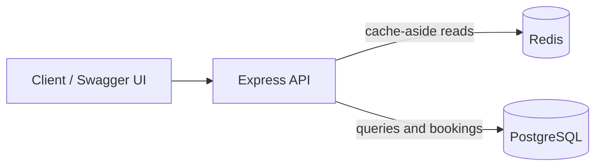
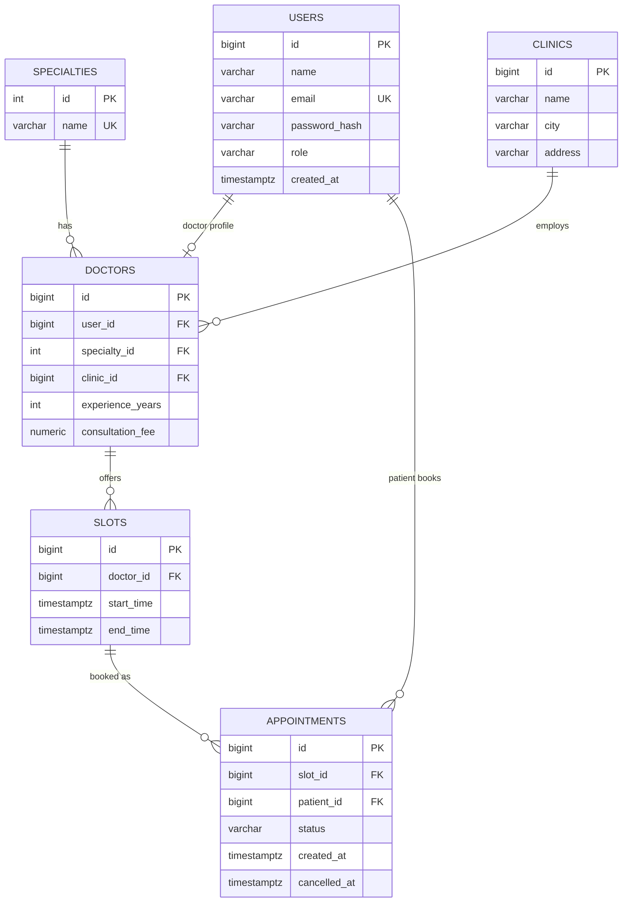

# MediSlot


A healthcare appointment booking backend. Patients search doctors by specialty and city, see free time slots, and book or cancel appointments. The database guarantees that a slot can never be double-booked, even when many people try at the same moment.

**Live demo:** https://medislot-hk2k.onrender.com
**API docs (Swagger):** https://medislot-hk2k.onrender.com/docs  
Free hosting sleeps after inactivity, so the first request can take up to a minute.

## Features

- Patient registration and login with JWT authentication and bcrypt password hashing
- Doctor search by specialty and city, with pagination
- Free-slot listing for a doctor on a given date
- Book and cancel appointments (patients only)
- **No double booking:** a partial unique index in PostgreSQL allows only one confirmed appointment per slot
- **Redis caching** (cache-aside with TTL) for doctor search and slot lists, with cache invalidation on every booking or cancellation; the app keeps working if Redis is down
- Interactive API documentation with Swagger UI
- One-command local setup with Docker Compose
- Seed script, concurrency test and load-test results included

## Tech stack

Node.js, Express, PostgreSQL 16, Redis 7, JWT, bcrypt, Docker and Docker Compose, Swagger UI (OpenAPI 3), autocannon. Deployed with Render (app), Neon (PostgreSQL) and Upstash (Redis).

## Architecture



A read request checks Redis first. On a miss it queries PostgreSQL and stores the result for a short time. Bookings and cancellations always go to PostgreSQL, and they clear the cached slot list for that doctor and day.

## Database design (ER diagram)



The schema is normalized (3NF). Availability is not stored as a flag: a slot is free when no confirmed appointment points to it, so there is no duplicated fact that can get out of sync.

## How double booking is prevented

Checking whether a slot is free and then inserting is unsafe, because two requests can both pass the check. Instead, the database enforces the rule:

```sql
CREATE UNIQUE INDEX one_confirmed_per_slot
  ON appointments (slot_id) WHERE status = 'confirmed';
```

If two requests try to book the same slot at the same instant, PostgreSQL accepts one and rejects the other with a unique violation, which the API turns into `409 Conflict`. Cancelled appointments are kept for history and do not block a new booking.

**Proof:** `scripts/concurrency-test.js` registers 50 patients and makes all of them book the same slot at once:

```
node scripts/concurrency-test.js <slotId> 50

Slot 5: 50 simultaneous booking attempts
Status counts: { '201': 1, '409': 49 }
PASS: exactly one booking succeeded
```

## API

| Method | Endpoint | Auth | Description |
|---|---|---|---|
| POST | `/api/auth/register` | none | Register a patient |
| POST | `/api/auth/login` | none | Log in and receive a JWT (valid 1 hour) |
| GET | `/api/doctors` | none | Search by `specialty`, `city`; paginate with `page`, `limit` (cached 60 s) |
| GET | `/api/doctors/:id/slots?date=YYYY-MM-DD` | none | Free slots for a doctor on a date (cached 30 s) |
| POST | `/api/appointments` | patient | Book a slot with `{ "slotId": 5 }` |
| GET | `/api/appointments/mine` | patient | List my appointments |
| DELETE | `/api/appointments/:id` | patient | Cancel my confirmed appointment |

Full request and response details: see the Swagger page at `/docs`.

## Run it locally

Requires Docker Desktop.

```bash
docker compose up -d --build
docker compose exec app node scripts/seed.js 50
```

- API: http://localhost:3000
- Docs: http://localhost:3000/docs
- Seed data: patients register themselves; doctors are `doctor1@medislot.com` and so on (password `Password123`); admin is `admin@medislot.com` (password `Admin1234`)
- Stop with `docker compose stop`; reset everything with `docker compose down -v`

Seeded slots cover the 5 days after the date you run the seed, so reseed when they pass.

## Performance

Measured on a local laptop with 10,000 doctors, 50 concurrent connections for 15 seconds (autocannon), searching doctors by specialty and city.

| Scenario | Query time (EXPLAIN ANALYZE) | Req/sec | Avg latency | p99 latency |
|---|---|---|---|---|
| No indexes, no cache | 2.557 ms | 1,827 | 26.86 ms | 43 ms |
| With indexes, no cache | 1.078 ms | 2,852 | 17.03 ms | 37 ms |
| With indexes + Redis cache | n/a | 7,727 | 5.98 ms | 11 ms |

- Indexes changed the doctors scan from a sequential scan to bitmap index scans (query time about 58% lower, throughput about 1.56x).
- Adding the Redis cache raised throughput about 4.2x over the starting point.
- The cached run repeats one URL, so it shows the best case for caching. Raw output is in the `results/` folder.

## Design decisions

- **Database-level guarantee over application checks:** the database is the one place that sees every request, so a constraint cannot be raced.
- **Cache is never the source of truth:** bookings always go to PostgreSQL, TTLs limit staleness, and the app falls back to the database if Redis is unavailable.
- **Parameterized queries everywhere** to prevent SQL injection.
- **Pagination with a capped page size** so a single request cannot return thousands of rows.

## Known limitations and next steps

- Slots and doctors are created by the seed script; there are no doctor or admin endpoints yet (the roles exist in the schema).
- No frontend yet; the API is explored through Swagger.
- Tests are limited to the concurrency script; an automated test suite would be the next addition.
- No rate limiting or email notifications yet.